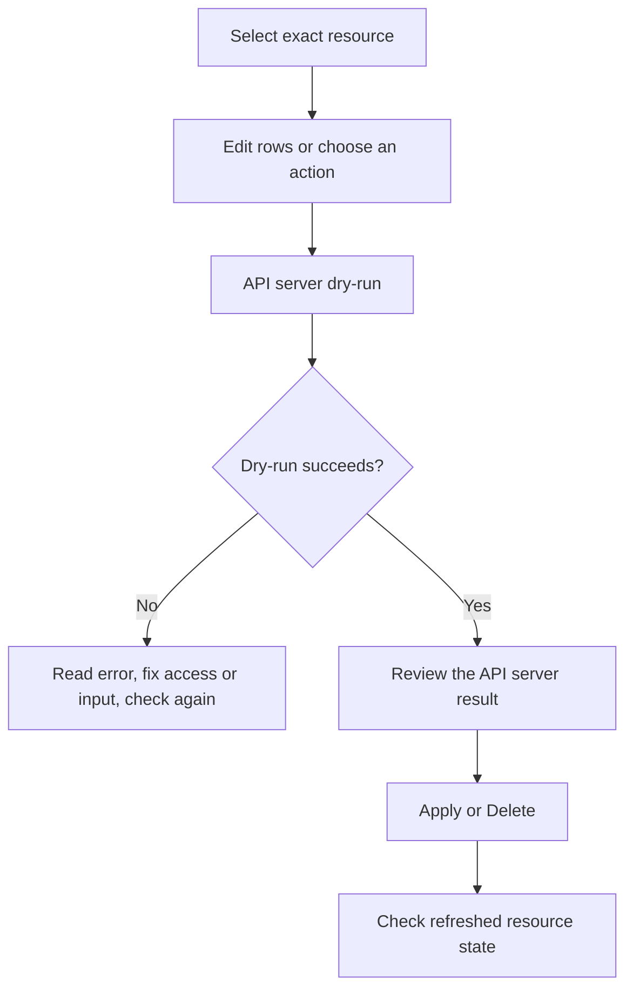
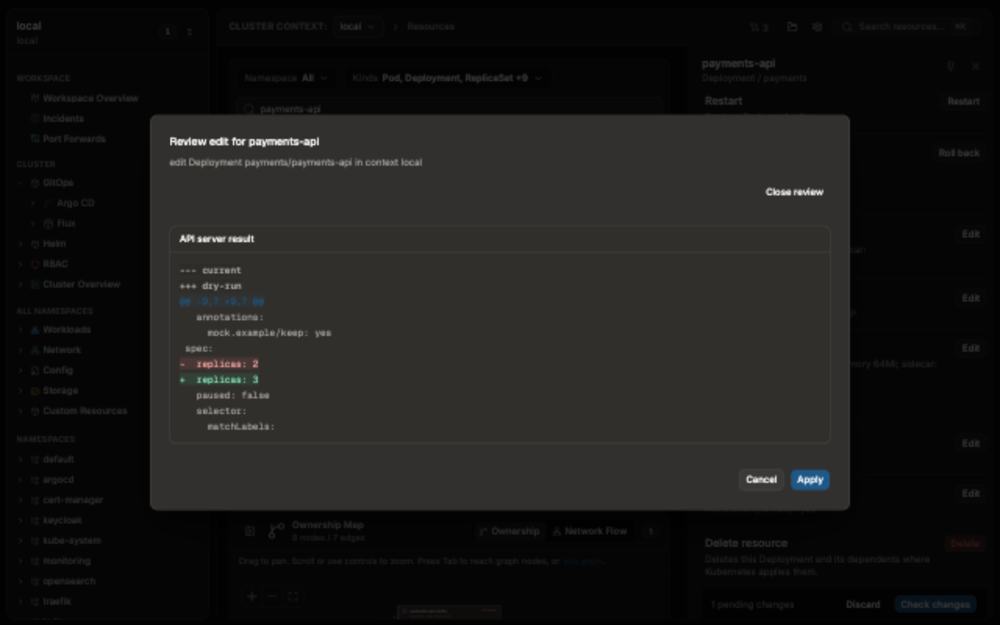

# Guarded Operations

Guarded operations change one selected Kubernetes resource through fixed, typed actions. Open the resource in Resource Details, then open **Actions**. The tab lists each action as a row, and **Filter actions** narrows the list.

Related: [Resource Details](https://github.com/Timpan4/kubecove/wiki/Resource-Details) · [GitOps](https://github.com/Timpan4/kubecove/wiki/GitOps-Argo-CD-and-Flux) · [Helm](https://github.com/Timpan4/kubecove/wiki/Helm-Reconciliation) · [RBAC](https://github.com/Timpan4/kubecove/wiki/RBAC-and-Permissions)

## Prerequisites

- Select one built-in, namespaced resource in a workspace context. Custom Resources and Secrets have no actions.
- Use a kubeconfig identity that is authorized for the action. The check is a Kubernetes dry-run, so it needs the same authorization.
- Confirm the exact target before changing it. An action never applies to a selector or a group of resources.

| Action | Row | Supported kinds |
| --- | --- | --- |
| Scale | **Replicas** | Deployment, StatefulSet |
| Pause or resume a rollout | **Rollout** | Deployment |
| Rollout restart | **Restart** | Deployment, StatefulSet, DaemonSet |
| Roll back to an earlier revision | **Revision** | Deployment |
| Edit container image, environment, requests and limits | **Image**, **Environment**, **Requests and limits** | Deployment, StatefulSet, DaemonSet |
| Edit labels and annotations | **Labels**, **Annotations** | Deployment, StatefulSet, DaemonSet, Pod, ConfigMap |
| Delete | **Delete resource** | Deployment, StatefulSet, DaemonSet, Pod, ConfigMap |

A row you are not permitted to use stays visible and locked, and shows the Kubernetes verb and resource it needs. If a permission check fails or is inconclusive, the row stays locked.

## Guard sequence

1. Every action starts with a dry-run against the API server. A dry-run changes nothing in the cluster.
2. The review dialog shows **API server result**, a diff between the current object and the object the server would store.
3. **Apply** runs the action. It repeats the dry-run and is rejected when the resource's UID or resourceVersion has changed since the review. In that case, check the changes again.
4. After a successful action, details, YAML, revisions and resource lists refresh. Inspect the refreshed state before follow-up work.

Changing the selected resource or the kubeconfig source discards pending edits and reviews.

## Edit a workload

Replicas, container fields, labels and annotations are edits. You can change several rows and review them together.

1. Select **Edit** on a row and change the value. Edited rows show **Pending**, and **Revert** restores one row.
2. Repeat for other rows. The bar at the bottom counts pending changes, and **Discard** clears them all.
3. Select **Check changes**.
4. Read the diff in the review dialog, then select **Apply** or **Cancel**.

Notes on individual rows:

- **Replicas** accepts zero or a positive integer and patches `spec.replicas`.
- **Environment** changes literal values. A variable that reads from a Secret or ConfigMap keeps its reference unless you replace or remove it.
- **Labels** and **Annotations** change the selected object's metadata. They do not change its Pod template or selector.

## Restart, pause, resume and roll back

These actions run on their own and keep any pending edits.

- **Restart** patches the Pod template annotation `kubecove.io/restartedAt`. It does not delete the workload.
- **Pause** and **Resume** on the **Rollout** row stop and continue a Deployment rollout.
- On the **Revision** row, choose a revision and select **Review rollback**. Rollback restores the complete Pod template of that revision, not only its image.

Each one opens the same review dialog before it applies.

## Delete one resource

1. Select **Delete** on the **Delete resource** row.
2. Read the review, then type the resource name to confirm.
3. Select **Delete**.
4. Verify the resource state after the refresh. The result reports the delete request. It does not prove that the resource has disappeared.

Delete targets one resource. The review names that resource. It does not analyze dependent resources.

## Skip change review

**Settings** → **Advanced** → **Skip change review** is off by default and warns before you enable it. When it is on, a successful dry-run applies without showing the diff, in every context. The dry-run still runs, a failed dry-run still opens the error, and delete always asks for the typed name.

## Failure and recovery

- **Dry-run fails:** nothing is applied. Read the Kubernetes error, correct the input, target or access, then check again.
- **Resource changed since review:** the apply is rejected. Check the changes again against the current object.
- **Forbidden or unauthorized:** request the least-privilege RBAC that the locked row names, in the target namespace. Do not retry until access is corrected.
- **Request error after submission:** the final cluster state may be unknown. Read the resource state before retrying.
- **Delete result:** confirm that the resource is gone before recreating it or taking a dependent action.

## GitOps and Helm caution

In **Details**, **Ownership** can show Argo CD, Flux or Helm ownership. When it does, make desired-state changes in the source repository or release workflow. A guarded operation changes the live Kubernetes object only. It does not update a GitOps source or Helm release values, and reconciliation can replace a direct change.

For managed resources, treat scale, restart and edits as temporary operational changes unless the owning workflow records them. Avoid deleting a managed resource until you understand what its controller will do.
