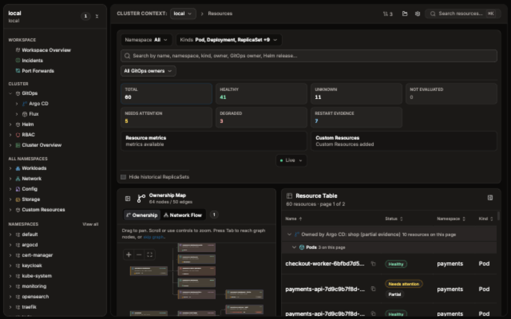

# KubeCove

KubeCove is a fast, local Kubernetes desktop GUI for cluster inspection and troubleshooting. It gives Kubernetes-aware operators and application developers a visual resource browser for context, namespace, application ownership, resource state, events, logs, metrics, YAML, topology, GitOps, Helm, and RBAC before taking action.

Kubernetes credentials remain on the Rust side of the desktop boundary. KubeCove does not deploy cluster agents, expose raw kubeconfig contents to the frontend, or provide arbitrary shell execution. Operations are narrow, typed, target-scoped, and explicitly confirmed.

## Start

1. [Download latest installer](https://github.com/Timpan4/kubecove/releases/latest). Installers are beta builds; OS trust prompts may require approval.
2. To keep cluster credentials and connectivity on a remote operations host or an operator-deployed Kubernetes container, follow [Run KubeCove on a remote host](https://github.com/Timpan4/kubecove/wiki/Remote-Server). The server requires sign-in, and each client gets its own session.
3. Make a readable kubeconfig context available through `$KUBECONFIG` or your default kubeconfig location.
4. Create a workspace. Choose a context, then narrow namespaces and resource kinds when useful.
5. Open a resource. Inspect details, events, logs, metrics, YAML, ownership, and related GitOps or Helm metadata before using a guarded action.

## Safety boundary

Inspection is default. Guarded workflows include Pod and selector-backed Service port forwarding, exact-Pod exec, selected-resource YAML apply, reviewed resource actions (scale, pause, restart, rollback, container and metadata edits, delete), and reviewed Argo CD refresh, sync and rollback operations.

YAML apply is limited to selected resources, validates identity, dry-runs before final confirmation, and blocks v1 Secret apply. Argo CD operations use the reviewed transport, while connected inspection can visibly fall back to a complete Kubernetes view when a required connected read fails. Flux remains inspection-only.

## Start and navigate

- [Install and update KubeCove](https://github.com/Timpan4/kubecove/wiki/Install-and-Update)
- [Create a workspace and choose scope](https://github.com/Timpan4/kubecove/wiki/Workspaces-and-Scope)
- [Use the workspace overview](https://github.com/Timpan4/kubecove/wiki/Workspace-Overview)
- [Browse Kubernetes resources](https://github.com/Timpan4/kubecove/wiki/Resource-Browser)
- [Inspect resource details](https://github.com/Timpan4/kubecove/wiki/Resource-Details)

## Inspect

- [Investigate incidents](https://github.com/Timpan4/kubecove/wiki/Incidents)
- [Inspect Argo CD and Flux](https://github.com/Timpan4/kubecove/wiki/GitOps-Argo-CD-and-Flux)
- [Review Helm reconciliation](https://github.com/Timpan4/kubecove/wiki/Helm-Reconciliation)
- [Review RBAC and permissions](https://github.com/Timpan4/kubecove/wiki/RBAC-and-Permissions)

## Operate safely

- [Scale, restart, or delete a supported resource](https://github.com/Timpan4/kubecove/wiki/Guarded-Operations)
- [Edit and apply selected-resource YAML](https://github.com/Timpan4/kubecove/wiki/Edit-and-Apply-YAML)
- [Start a guarded Pod exec session](https://github.com/Timpan4/kubecove/wiki/Pod-Exec)
- [Start and manage a port forward](https://github.com/Timpan4/kubecove/wiki/Port-Forwarding)

## Configure and troubleshoot

- [Use Settings, updates, and diagnostics](https://github.com/Timpan4/kubecove/wiki/Settings-Updates-and-Diagnostics)
- [Understand safety, data handling, and architecture](https://github.com/Timpan4/kubecove/wiki/Safety-Data-and-Architecture)
- [Troubleshoot common symptoms](https://github.com/Timpan4/kubecove/wiki/Troubleshooting)
- [Look up KubeCove terms](https://github.com/Timpan4/kubecove/wiki/Glossary)

## Help and documentation

- [Report a product issue](https://github.com/Timpan4/kubecove/issues)
- [Report a documentation gap or error](https://github.com/Timpan4/kubecove/issues/new?template=documentation.yml)
- [Report a vulnerability privately](https://github.com/Timpan4/kubecove/security/policy)
