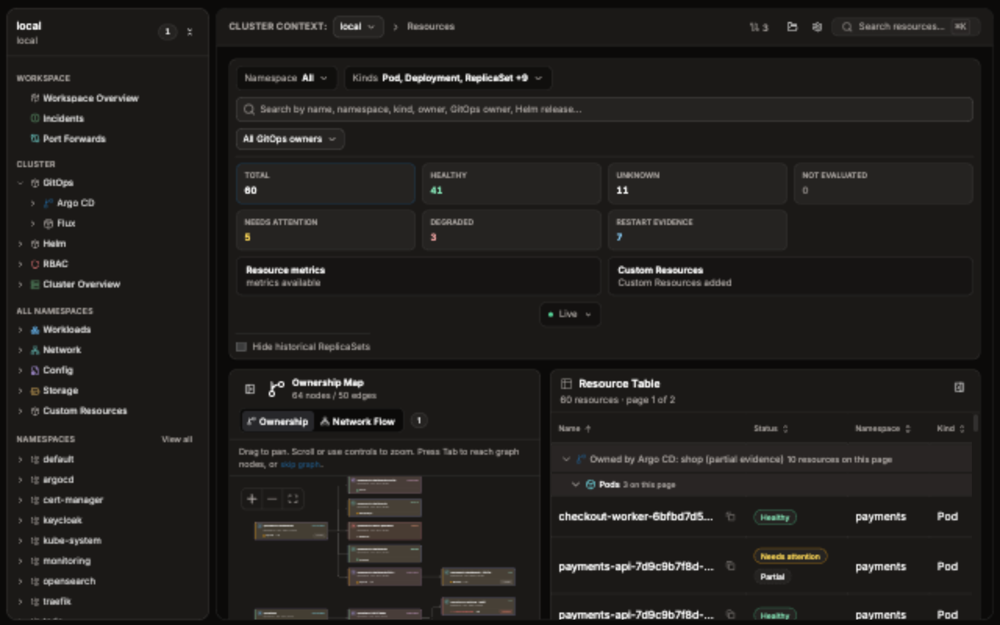

# Resource browser

The Resource browser lists Kubernetes objects inside the workspace's saved contexts, namespaces, and kinds. A workspace with more than one context shows their objects in one merged table. Opening or filtering a row is read-only. Changes live behind the separate guarded-operation flows.

## Find a resource

1. Open **Resources** from the workspace.
2. Use **Namespace** and **Kinds** to narrow the saved scope.
3. Search by name, namespace, kind, owner, GitOps owner, or Helm release. With more than one context, search also matches the context name.
4. With more than one context, use **Context** to show rows from only the contexts you pick. Selecting every context, or none, shows all of them.
5. Select a health summary or **All GitOps owners** when you need a narrower result.
6. Sort or group the table, then select a row to open its details.
7. Select **Clear** to remove active filters, including the Context filter.

The table can show **Name**, **Namespace**, **Kind**, **Status**, **Context**, **Ready**, **Restarts**, **CPU**, **Memory**, **Owner**, and **Age**. **Context** appears only when the workspace has more than one context. Available columns depend on the object and APIs returned by the cluster.

## Read several contexts

When the workspace has more than one context, KubeCove reads each context and merges the rows into one table. Each row keeps its own context. Objects with the same name in different contexts appear as separate rows. When rows tie on name, they stay in workspace context order.

The status line reads `{N} resources · {C} contexts · page {p} of {P}`. `C` counts the contexts the workspace reads, even when the Context filter narrows the rows. With one context, the status line shows no context count.

If one context fails to load, the rows from the other contexts stay visible and a warning names the failed context. If every context fails, the view names each context.

Realtime updates apply per context. A change in one context updates only that context's rows. If one context deletes an object, the same-named object in another context stays in the table.

Owner and Helm groups split by context. The same Argo CD Application or Helm release in two contexts makes one group for each context. Each group label ends with the context name, for example `Helm release: metrics-gateway · admin@solid-k8s`. Ownership and Helm groups never combine objects from different contexts.

## Read the health summaries

| Filter | Meaning |
| --- | --- |
| **Total** | All objects collected for the current scope. |
| **Healthy** | Objects whose observed state matches KubeCove's healthy rules. |
| **Unknown** | Objects with a recognized health semantic that current evidence cannot classify. |
| **Not evaluated** | Objects for which KubeCove has no health semantic. |
| **Needs attention** | Objects with warning or incomplete signals that deserve inspection. |
| **Degraded** | Objects whose available condition or workload signals indicate degradation. |
| **Restart evidence** | Objects associated with container restart signals. Restarts are evidence, not a health state. |

These labels summarize available evidence. They are not Kubernetes authorization decisions, root-cause diagnoses, or proof that unlisted objects are healthy.

## Use table and map views

**Resource Table** is the quickest path to filtering and row details. You can sort results, collapse groups, page through larger result sets, and pin frequently inspected resources. Pins are per context, so pinning an object in one context does not pin the same-named object in another context.

**Map** visualizes ownership relationships for the loaded objects. Use it to follow a workload toward its controllers or related objects. With more than one context, the map shows one context at a time. A **Map context** select lists the workspace's contexts in workspace order and starts on the primary context. Map nodes and edges come from the selected context only. Metrics and topology are supplementary: either can be missing when the API, scope, or access does not provide enough data.

Use the status menu in the Resource browser header to check live-watch state and reload errors. Choose **Refresh (clear cache)** to clear cached data for this view and reload active reads; filters and selection are preserved. Health badges show their source and raw status in a tooltip on hover or keyboard focus. Partial-assessment badges remain visible.

Custom Resources appear when their discovery and loading setting is enabled. KubeCove discovers the kinds exposed by the selected cluster rather than assuming every cluster has the same APIs.

## Use resource actions

The **Actions** tab exposes a limited set of guarded operations for selected resources:

| Kind | Supported actions |
| --- | --- |
| Deployment | Change replicas, pause or resume, restart, roll back to an owned ReplicaSet revision, edit containers or metadata, delete |
| StatefulSet | Change replicas, restart, edit containers or metadata, delete |
| DaemonSet | Restart, edit containers or metadata, delete |
| Pod | Edit metadata, delete |
| ConfigMap | Edit metadata, delete |

Container edits target a regular container by name. They can change its image, literal environment variables, and resource requests or limits. Metadata edits change labels and annotations on the selected object, not a workload's Pod template or selector. Other kinds and Secret edits are not part of this Actions allowlist.

Opening a row reads its details, YAML, and events from that row's context. The detail header names the context when the workspace has more than one. A guarded operation started from a row targets that row's context, and its review names that context.

Actions remain visible when Kubernetes permission is denied or cannot be determined, but the unavailable action is locked and shows the required permission. You can collect several edits for one object and review them as one atomic change. By default, KubeCove sends a server-side dry-run and shows a diff between the current YAML and the API server's result before applying. If the resource UID or resource version changes after review, execution is rejected as stale. A failed dry-run cannot be applied.

In global **Settings > Advanced**, **Skip change review** skips the successful review screen only, after an explicit warning. Server-side dry-run still runs, and exact deletion always requires typing the resource name. The selected-resource YAML editor keeps its separate second **Apply** step.

## Understand loading and empty states

| Message | Meaning and next check |
| --- | --- |
| **No cluster context** | Choose an available context or edit the workspace. |
| **No resource scope** | Add usable contexts or kinds to the workspace. |
| **Failed to load resources** | Check cluster reachability, kubeconfig source, and list permissions. |
| **No resources match current scope and filters** | Clear filters or widen namespace and kind scope. |
| **Loading ownership map** | Resource rows may be ready while topology is still loading. |
| **Failed to load ownership map** | Select **Retry**; table inspection can remain available. |

For a failed context in a multi-context workspace, check that context's cluster reachability, kubeconfig source, and list permissions. The warning names the context.

Realtime watches refresh supported resource data while connected. A disconnected or restricted watch does not make the last rendered state an authoritative live view; refresh and compare with the Kubernetes API before acting.

Next: [inspect one resource](https://github.com/Timpan4/kubecove/wiki/Resource-Details) or [investigate incident signals](https://github.com/Timpan4/kubecove/wiki/Incidents).
