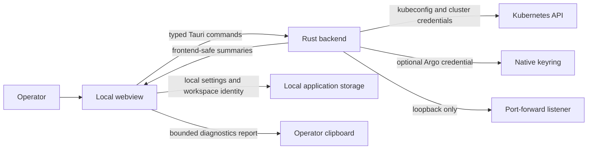

# Safety, data handling, and architecture

KubeCove reads Kubernetes data through the kubeconfig contexts you select and changes a cluster only through typed, confirmed operations. It deploys no cluster agent and has no general shell bridge. This page describes the desktop app. For the headless server's sign-in, sessions, and storage, see [Run KubeCove on a remote host](https://github.com/Timpan4/kubecove/wiki/Remote-Server).

## Local data

Local settings store display, YAML, live-session, and Secret-redaction preferences, saved Argo CD server profile metadata, and workspaces. Argo CD credentials are not stored in settings.

Kubeconfig source settings are stored in the application configuration: the selected environment-variable name, the added file paths, and the source-label preference. Kubeconfig files, client credentials, tokens, and certificates stay in the backend and are not returned to the interface.

You export a workspace through a native file dialog. An exported file holds operational metadata such as context and namespace names, so read it before sharing it.

## Credentials and Argo CD

Argo CD connections are set up per workspace from the GitOps view or from Application details. A server profile can be saved without a credential. **Remember credential in native keyring** stores the credential in the operating-system keyring and reconnects when the workspace opens. Without it, the credential lasts for the session only.

HTTPS through a cluster Service accepts only the certificate fingerprint you confirmed. The fingerprint is stored with a remembered credential. For an external URL, custom CA material and invalid-certificate acceptance last for the session only. Accepting invalid certificates turns off certificate validation for that session, so use it only to diagnose a server you trust, then disconnect.

The Argo CD API and the Kubernetes CRDs are separate transports. Connected inspection can fall back to Kubernetes when a required connected read fails. The result then shows the connected failure and that the data came from Kubernetes. A reviewed operation does not switch transports after confirmation.

## Secrets

Secret values are redacted by default in resource details and YAML. A reveal reads one selected Secret key through the backend. Reveal a value only when you are authorized to, and do not copy it into logs, tickets, or shared reports.

Selected-resource YAML apply blocks core `v1` Secrets, because applying redacted values could overwrite live data. Secret fields from a connected Argo CD server stay redacted.

## Diagnostics and reports

Diagnostics are off by default, bounded, and held in memory. Clearing them removes the collected frontend and backend events. A copied latency report redacts identifiers unless you select **Include identifiers**. Review a copied report before sending it outside a trusted support channel.

## Local listeners and the desktop boundary

Port forwards listen on the loopback address only, so local processes can reach the forwarded port and other hosts cannot. Pod exec, port forwarding, resource inspection, YAML, and guarded operations cross the webview boundary only through registered typed Tauri commands. The backend validates the scope and returns frontend-safe data. It exposes no general shell and no endpoint that returns raw kubeconfig contents.

## Report an issue safely

Open a [documentation issue](https://github.com/Timpan4/kubecove/issues/new?template=documentation.yml) or a [product issue](https://github.com/Timpan4/kubecove/issues) with the symptom, the sanitized context, the operation, and reproduction steps. Remove Secret values, tokens, kubeconfig contents, private hostnames, and copied identifiers. For vulnerabilities, follow the [security policy](https://github.com/Timpan4/kubecove/security/policy).
