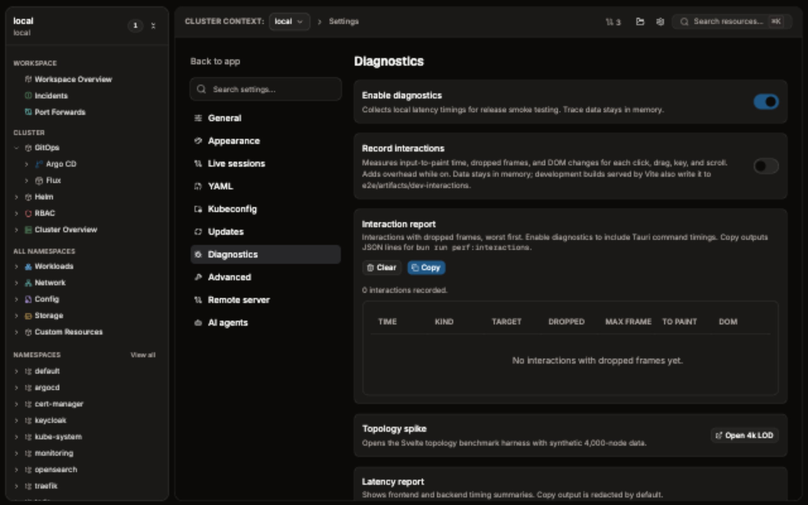

# Settings, updates, and diagnostics

Open **Settings** from app navigation. Settings are global preferences. Argo CD connections are per workspace; manage them from **Argo CD connection** in the workspace GitOps view.

## General

| Control | Default | Effect and risk |
| --- | --- | --- |
| Show exact timestamps | Off | Adds absolute times beside relative ages. |
| Timestamp timezone | Local | Changes exact timestamps and tooltips to local time or UTC. |
| Show CPU and memory footer | Off | Shows app-process CPU, WSS, RSS, and PSS. Windows reports WSS, Linux and macOS report RSS, and Linux reports PSS. Figures a platform lacks show `--`. |
| Measure working set (WSS) | Off | Linux only, while the footer is on. Each footer refresh resets the kernel's referenced-page bits for KubeCove processes, so WSS shows memory touched since the previous refresh. The kernel may then reclaim those pages sooner. |
| Show ownership map by default | On | Opens the ownership map in resource views. |
| Expand timeline by default | Off | Opens resource timeline messages and facts. Individual entries can still be collapsed. |
| Redact secrets | On | Keeps Secret values hidden by default. Connected Argo Secret values remain masked. |
| Keep full map visible during selection | Off | Keeps unrelated ownership branches visible; large namespaces can render more slowly. |
| Show unavailable GitOps providers | Off | Shows disabled Argo CD and Flux groups when their CRDs are absent. |
| Show Custom Resources | On | Loads Custom Resources after native resources are visible. |

## Live sessions

| Control | Default | Effect and risk |
| --- | --- | --- |
| Auto-start saved port forwards | Off | Starts saved Service port-forward presets when restoring a workspace. Verify target and local port before enabling. |
| Keep live sessions across workspace switches | Off | Leaves port-forward and Pod exec sessions running after leaving their scope. Stop sessions explicitly when no longer needed. |

## Appearance

- **Log layout** sets how entries appear in the Logs tab: Stacked, Gutter, or One line.
- **Resource group order** orders the groups in the Resource Table. Drag kinds between lanes, or focus a kind and use the arrow keys. Column sorting still orders rows inside each group.

## Advanced

**Skip change review** is off by default and warns before you enable it. When it is on, a successful dry-run in the Actions tab applies without showing its diff, in every context. Dry-run still runs, and delete always asks. See [Guarded Operations](https://github.com/Timpan4/kubecove/wiki/Guarded-Operations).

## Remote server

The desktop app can connect to a KubeCove server with a token or OIDC sign-in. See [Run KubeCove on a remote host](https://github.com/Timpan4/kubecove/wiki/Remote-Server).

## YAML

| Control | Default | Effect and risk |
| --- | --- | --- |
| YAML shape | Kubectl view | Select Kubectl view or Apply clean output. |
| YAML encoding | YAML | Select YAML or KYAML in YAML panels. |
| YAML diff appearance | Clean | Select clean or Git-style rendering for selected-resource dry-run diffs. |
| YAML error lens | On | Shows editor diagnostics below YAML lines. |
| Allow YAML force-conflicts | Off | Allows guarded YAML operations to take server-side field ownership. Review dry-run diff and confirmation target before force-applying. |

## Kubeconfig

Kubeconfig sources default to `KUBECONFIG`. Paths from the selected environment variable are read first; when it is unset or empty, standard `KUBECONFIG` provides the base when set, otherwise the platform-default kubeconfig does. App-added paths are read afterward in their configured order, so they augment rather than replace the base source. Source labels are on by default, and full paths appear only in this Settings section.

Changing source, paths, or order changes contexts available to workspaces. Remove stale paths rather than leaving them to generate load warnings.

## Updates

Open **Updates** and select **Check**. Review the release information, then select **Install**. KubeCove downloads the update and needs **Relaunch** to finish. Development builds do not check for updates.

If a check fails, confirm network access to GitHub release downloads and retry. Do not replace application files by hand while the installer is running.

## AI agents

**AI agents** turns on a read-only MCP endpoint at `http://127.0.0.1:47615/mcp` for agents such as Claude Code. It is off by default, accepts only loopback connections and needs the bearer token that **Copy token** and **Copy Claude Code command** copy. See [AI agents (MCP)](https://github.com/Timpan4/kubecove/wiki/AI-Agents-MCP).

## Diagnostics

Diagnostics are off by default. Enable them to collect frontend and backend latency timings, render counters, and bounded trace events in memory. They are intended for local investigation; disable them when finished. **Record interactions** also measures input-to-paint time, dropped frames, and DOM changes for each click, drag, key, and scroll.

**Latency report** shows frontend timings, render counters, and backend timings. **Copy** creates identifier-redacted output by default. Leave **Include identifiers** unchecked unless recipient and destination are trusted. **Clear** removes frontend and backend trace data from memory.

For report contents, retention, and support sharing, see [Safety, data handling, and architecture](https://github.com/Timpan4/kubecove/wiki/Safety-Data-and-Architecture).
